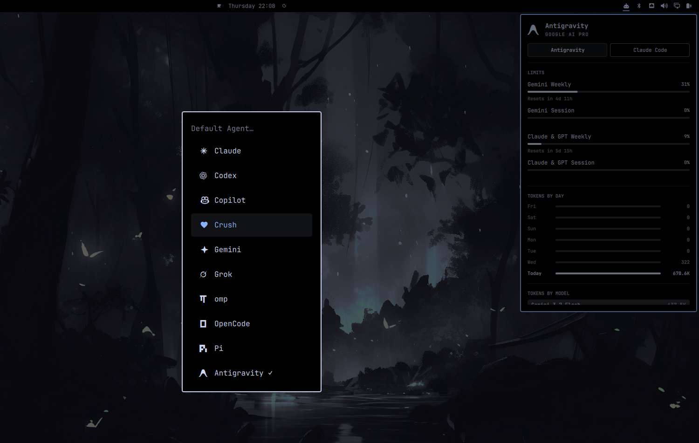
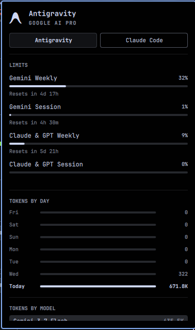
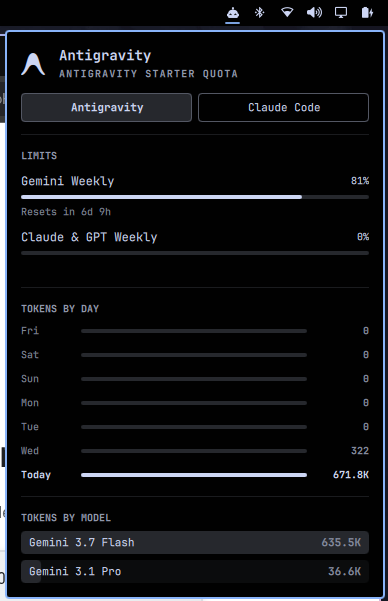
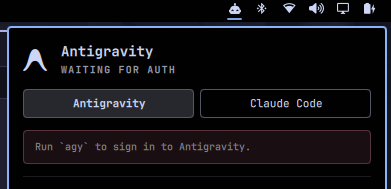
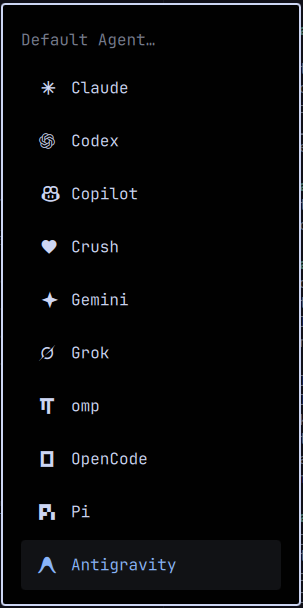
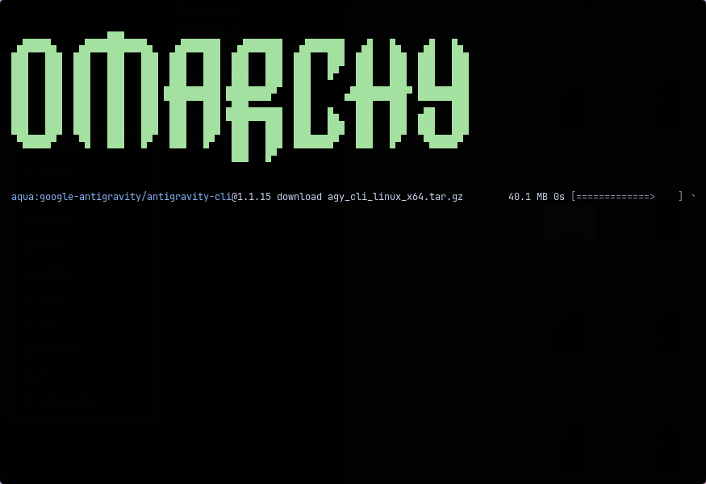

# Antigravity agent integration



Adds the Antigravity CLI (`agy`, Google's Gemini Code Assist terminal agent) as an
Omarchy agent option, alongside the agents shipped by `omarchy.agents`.

## What it does

- **Agents panel tab** — a service writes a usage record to
  `~/.local/state/omarchy/agents/usage/antigravity.json` every 5 minutes (and at
  shell start). The existing agents panel picks it up automatically and shows a
  new "Antigravity" subscription card.

  <p>
    
    
    
  </p>

- **Defaults → Agent menu entry** — a new `Antigravity` row under
  _Defaults → Agent_ in the omarchy menu. Selecting it installs `agy` on demand
  via mise (`aqua:google-antigravity/antigravity-cli`) and launches the TUI.

  <p>
    
    
  </p>

- **Agent launch** — the bar's agent icon / `omarchy agent` flow launches `agy`
  when Antigravity is the default agent (with `--dangerously-skip-permissions`,
  or `--prompt-interactive "<prompt>"` for a one-shot prompt).

## How the subscription record is built

The collector (`bin/omarchy-agent-usage-antigravity`) is a dependency-free
Python 3 script. It builds the same record schema as the other agent collectors:

| Field                                                                           | Source                                                                                                                                                                                                                |
| ------------------------------------------------------------------------------- | --------------------------------------------------------------------------------------------------------------------------------------------------------------------------------------------------------------------- |
| `tierLabel` | The plan declared in `~/.config/omarchy/agents/antigravity.json` (see below); `agy` does not report it. |
| `limits` | `agy -p /quota --output-format json`: agy's own quota command (no model turn), so sign-in and tokens never leave agy. Cached for 5 minutes. |
| `todayTotalTokens` / `todayTokensByModel` / `modelUsage`                        | Scanned from local conversation transcripts (`~/.gemini/antigravity-cli/brain/*/logs/transcript.jsonl`), tracking model switches and token counts per model.                                                          |
| `todayPrompts` / `totalPrompts`                                                 | The CLI's prompt history and transcript records.                                                                                                                                                                      |
| `todaySessions` / `totalSessions` / `activeDays` / `activeDates` / `recentDays` | Brain transcripts combined with `conversation_summaries.db` (`~/.gemini/antigravity-cli/`) for 7-day token and prompt activity charts.                                                                                |
| `usageStatusText` / `authHelpText` | "Antigravity limits unavailable" plus `Run \`agy\` to sign in to Antigravity.` when agy is missing, signed out, or offline and no earlier limits are cached. |

The plugin never reads agy's credentials and makes no network calls of its own;
the only network traffic is whatever `agy /quota` does itself.

**Tier label:** `agy` does not report the plan, so the label comes from
`~/.config/omarchy/agents/antigravity.json`:

```json
{ "tierLabel": "Gemini Code Assist" }
```

When it is absent, the neutral label `Antigravity` is used.

## Dependencies and privileges

- **Runtime:** `python3` (collector), `jq` (menu guard and shims), `mise`
  (on-demand install of the prebuilt `agy` release from the aqua registry, which
  downloads it over HTTPS as your user — no root and no local build), and `agy`
  itself for limits.
- **Reads:** `~/.gemini/antigravity-cli/` (history, transcripts, and SQLite
  databases opened read-only).
- **Writes outside the plugin folder:** the menu row, the three shims listed
  under Install, the marked PATH blocks in `~/.bashrc` and
  `~/.config/hypr/hyprland.lua`, the usage record in
  `~/.local/state/omarchy/agents/usage/`, cache files in
  `~/.cache/omarchy/agent-usage/antigravity-*`, and
  `~/.config/omarchy/defaults/agent` when you pick Antigravity.
- **Runs:** `install.sh` on every shell start (idempotent), the collector every
  5 minutes and after agy activity, and `uninstall.sh` on disable or remove.
- **No root, no system files, no network calls of its own.**

## Install

```sh
omarchy plugin add https://github.com/PedroZamecki/omarchy-antigravity --enable
```

Enabling is all that is needed: the service runs `install.sh` itself on load.
The script is idempotent and safe to re-run by hand after `omarchy refresh`:

```sh
~/.config/omarchy/plugins/agy-integration/install.sh
```

It touches exactly three places outside the plugin folder:

1. Adds or updates the `setup.default.agent.antigravity` row in
   `~/.config/omarchy/extensions/omarchy-menu.jsonc`. The row carries a `when:`
   guard on the plugin folder, so it renders nothing if the plugin is gone, and
   calls the wrapper by absolute path so it works even before PATH is updated.
2. Writes three small shims into
   `~/.local/share/agy-integration/bin/` — `omarchy-default-agent`,
   `omarchy-agent`, and `omarchy-agent-usage-update` — so the menu rows, bar
   launch, and panel refreshes include Antigravity alongside the built-in
   agents. Each shim only forwards to the matching script in this plugin's
   `wrappers/`. A dedicated directory is used because current Omarchy puts
   `/usr/share/omarchy/bin` and `/usr/bin` ahead of `~/.local/bin`, where shims
   would never win.
3. Adds a marked block to `~/.bashrc` and to `~/.config/hypr/hyprland.lua` that
   puts that shim directory first on PATH. The menu and agents panel resolve
   commands through `bash -lc`, and Hyprland dispatches the agent keybinding
   from its own environment, so both places need it. The blocks are idempotent
   and removed by `uninstall.sh`.

Nothing is installed system-wide and no backup files are created. The icon font
(`fonts/omarchy-antigravity.ttf`, a custom glyph built from the Antigravity SVG
mark) is loaded into the shell process by `Service.qml`, and the usage collector
runs from `bin/` in place.

`install.sh` refuses to touch a shim or menu row it did not create, and refuses
to write through a symlink, rather than overwriting either. The PATH blocks are
inserted only once, after resolving a dotfiles symlink to its target.

## Known limitations

- The `omarchy default agent <name>` and `omarchy agent` CLI groups are resolved
  by Omarchy's dispatcher from its own `/usr/share/omarchy/bin` directory only,
  so they keep using the packaged scripts that do not know `antigravity`.
  Calling `omarchy-agent` or `omarchy-default-agent` directly works, as do the
  interactive paths (menu selection, menu checked-state, bar launch,
  keybinding).
- **First install in a running session.** The menu and bar pick up the new PATH
  block immediately because they spawn `bash -lc`. Hyprland only reads
  `hyprland.lua` at startup, so the agent keybinding starts using the wrapper
  after a relogin (or `hyprctl reload`). Selecting Antigravity from the menu
  works right away.
- **Agents panel icon.** The panel only looks for marks inside its own `assets/`
  folder, so the record `id` is a relative path
  (`../../…/agy-integration/assets/antigravity`) that resolves to this
  plugin's SVG. That id therefore contains your home directory path, which also
  lands in synced snapshots when `syncMode` is on. The usage-update shim treats
  that id and `antigravity` as the same agent, so disabling Antigravity in the
  panel's settings still works.

## Uninstall

Removal is automatic. Omarchy has no disable or uninstall hook (disabling a
plugin reloads the whole shell, so a plugin cannot run code on the way out), so
the shims act as the hook:

```sh
omarchy plugin disable agy-integration   # or: omarchy plugin remove agy-integration
```

- The menu row's `when:` guard asks `omarchy plugin list` whether the plugin is
  enabled, so the row disappears as soon as it is disabled or removed.
- The next time anything calls one of the shims (the agents panel's refresh, a
  launch, picking a default agent), the shim sees the plugin disabled or gone,
  runs `uninstall.sh` (or, if the folder is already deleted, removes itself, the
  PATH blocks, the usage record and a `defaults/agent` set to `antigravity`), and
  hands the call to the packaged Omarchy command.
- If the lookup itself fails, the shim keeps working instead of tearing down a
  live install.

To revert everything by hand at any time:

```sh
~/.config/omarchy/plugins/agy-integration/uninstall.sh
```

This removes the menu row, the three shims (only if they still carry this
plugin's marker) and their shim directory, the marked PATH blocks from
`~/.bashrc` and `~/.config/hypr/hyprland.lua`, the usage state and cache files,
and a `defaults/agent` set to `antigravity`. It is idempotent.
